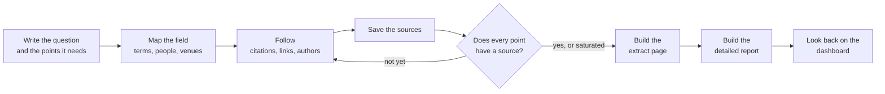
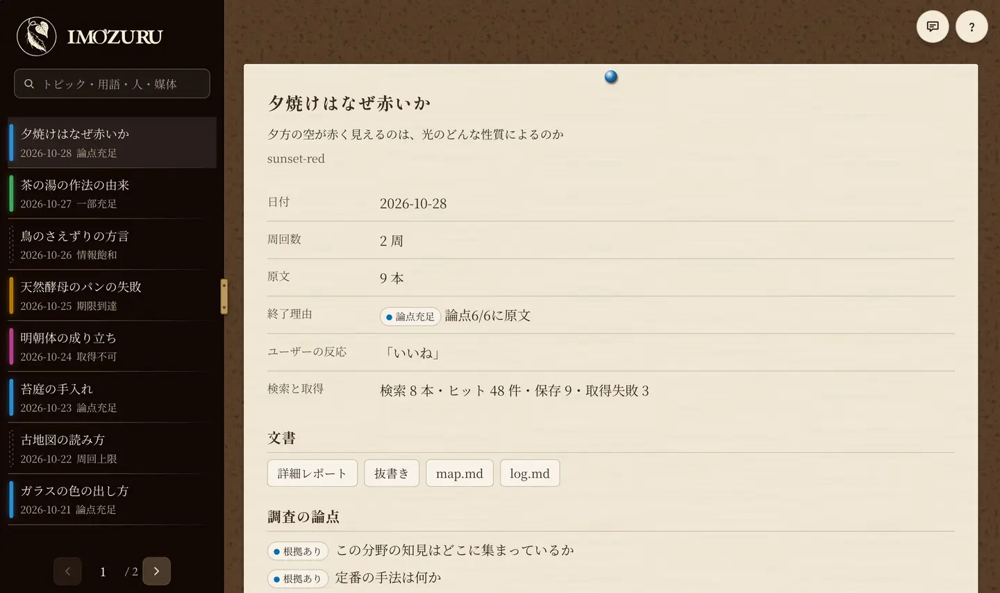

# imozuru

<picture>
  <source media="(prefers-color-scheme: dark)" srcset="assets/brand/logo/imozuru-lockup-light.svg">
  
</picture>

[日本語](README.md) | English

imozuru is a Claude Code skill that digs into an unfamiliar field, pulling one lead after another until it reaches the original sources.
It applies ideas from information-seeking research in library and information science, such as Bates's berrypicking, Ellis's model of information-seeking behaviour, and Kuhlthau's Information Search Process.

An AI judges better in a field once it has collected that field's explicit knowledge and know-how.
Gathering the explicit knowledge and know-how written in original sources, as material for the AI's judgement, has been imozuru's role from the start.
The 2.0 major update puts the weight on what people read.
It adds a detailed report that explains the field at the reader's level, and a dashboard that shows every investigation on one page.
Changes by version are listed in [CHANGELOG.md](CHANGELOG.md) (in Japanese).

The name comes from *imozuru-shiki* (芋づる式), the Japanese idiom for things coming up one after another, like sweet potatoes pulled up on a single vine.

> **Language note**: The skill's instructions (`SKILL.md`), the messages from its scripts, and the labels on the extract page are in Japanese. Claude reads the instructions in any language, but this skill has only been tried with requests written in Japanese.

## How it differs from existing AI research methods

Ask an LLM to "look into" something without a skill, and it tends to read the top few search results and return a summary.
A summary is quick to read, but the details users need for their own judgement tend to drop out.
And while users don't know the field's terms they can't choose good search words, so the search ends up staying within the words they first thought of.

imozuru first finds *the field's terms, its central people, and the venues where knowledge collects*, then follows citations, links, and authors from there to gather original sources.
It saves them without summarising and goes only as far as pointing, for each point the answer needs, to "which file, which lines".
The AI uses the gathered sources as material for its judgement, and the user can read the sources at the locations given to check what that judgement rests on.

## The skill's flow



Claude first writes down the question and the 3 to 6 points needed to answer it.
Next, two searchers (subagents that search the web) with different approaches collect terms, people, and venues into a map (`map.md`).
After that, it follows references, citing works, and authors until it finds the sources.
In fields without papers, it follows links inside articles and notes such as "I based this on so-and-so's post".

Sources it finds are saved to `sources/`, and 404 pages and login walls are dropped after checking their content.
When every point has a source, or no new sources turn up, the search stops.
Finally, it builds a page that lists passages cut from the sources, point by point (the extract page), and an explanation of the field (the detailed report).

Watch mode (`/imozuru watch <topic>`) runs separately from the investigation flow above.
It collects new posts from the venues a dig turned up (Qiita and Zenn tags, note, YouTube, blogs, arXiv) via RSS and lists them.

## Install

### As a Claude Code plugin

Add this repository as a marketplace and install the plugin.

```text
/plugin marketplace add MaryCache/imozuru
/plugin install imozuru@imozuru
```

The plugin carries no version number, so every commit to main counts as a new version.
To stay up to date automatically, turn on auto-update for imozuru in the marketplace screen of `/plugin`.
To update by hand, run `claude plugin marketplace update imozuru`.

### With the skills CLI

You can also install it with the [skills](https://github.com/vercel-labs/skills) CLI.

```sh
npx skills add MaryCache/imozuru
```

To install by hand, copy `skills/imozuru/` to `~/.claude/skills/imozuru/`.

## Requirements

The scripts run on the Python 3.10+ standard library alone, and use the following commands when they are installed.

| Command | Used for | When missing |
|---|---|---|
| `pdftotext` (poppler or Xpdf) | Extracting text from PDFs | The PDF text cannot be read and the fetch reports `FAIL` |
| `pdftoppm` (poppler or Xpdf) and `tesseract` | OCR for old PDFs with no text layer | That PDF reports `FAIL` |
| `tesseract` language data `jpn` and `jpn_vert` | Reading Japanese scans, both horizontal and vertical (used automatically when installed; set `IMOZURU_OCR_LANG`, e.g. `jpn+eng`, to choose) | OCR runs in English only; a Japanese PDF reports `FAIL` because the recognition confidence is low |
| `yt-dlp` | Downloading YouTube captions | Videos report `FAIL` |
| [ax](https://github.com/yusukebe/ax) | Turning HTML into Markdown | Falls back to the standard library and extracts the text only (ax keeps headings and tables better) |

`chain.py`, which follows citations, uses the [OpenAlex](https://openalex.org/) API, and no API key is needed.

## Usage

Ask Claude Code something like this.

```
芋づる式に調べて: 歌ってみたの MIX で、上手い人がどういう順番で処理しているか
(Dig into this: in vocal-cover mixing, in what order do skilled mixers apply their processing?)
```

```
Gaussian Splatting ってよく聞くけど全然わからない。論文とか解説の流れを掘ってほしい
(I keep hearing about Gaussian Splatting but have no idea what it is. Dig through the papers and explainers.)
```

```
/imozuru watch react
```

Results are saved to `~/research/<topic>/` in this form.

```
map.md         question, short title, research points, terms, people, venues, source table, next leads
log.md         per round: what was searched, what turned up, decisions and why
sources/       saved sources
extracts.json  extracts
report.html    extract page
queries.jsonl  every hit for every search query
fetch-log.jsonl fetch record (URL and OK/FAIL)
digest.json    explanation for the detailed report
digest.html    detailed report (explanations at Lv1 to Lv3, plus the full search record)
```

## Reading and looking back

The sources are shown in forms a person can read and judge for themselves.

### Extract page

A page that lists passages cut from the sources, point by point.
A sample is in `examples/demo/`, and this command tries the script on its own.

```sh
python3 skills/imozuru/scripts/report.py examples/demo
```

Why the passages are checked by machine is explained under "Why extracts are checked by machine" below.

### Detailed report

A page that explains the field in three versions for readers with different background knowledge.
Every sentence carries a quotation from a source as its evidence, and the full record of what was searched and what turned up comes with it.
Claude writes the explanation once the search has stopped, and `digest.py` checks every quotation against the sources before building the page.
Why it has two layers, explanation and record, is explained under "The two layers of the detailed report" below.

### Research dashboard



This page was added in 2.0.
The dashboard brings every investigation in the research folder (by default `~/research`) together on one page, one topic each.
A topic is one question and everything gathered for it, which is one folder inside `~/research`.

```sh
python3 skills/imozuru/scripts/dashboard.py ~/research
```

This writes `~/research/index.html`.
The home view summarises why each investigation stopped, where the sources came from, and how many rounds of following citations and links it took.
Choosing a topic in the sidebar opens its details: research points, rounds, sources, and documents; the detailed report and the extract page open inside the same view.
The sidebar search covers titles, questions, terms, people, and venues, and also matches hiragana and romaji.
The "?" button at the top right opens the help, which explains each part of the screen.
While a document is open, the button at the bottom left saves it as a PDF, and the speech-bubble button at the top right sends feedback to the author.
The dashboard's labels are in Japanese.

### On a phone

Serving the dashboard lets you open it in a phone's browser.

```sh
IMOZURU_SERVE_TOKEN=<passphrase> python3 skills/imozuru/scripts/dashboard.py ~/research --serve 8765
tailscale serve --bg 8765
```

The server listens only inside the PC (127.0.0.1), and a page opens only with the passphrase in its URL.
From the phone, relay it to your own devices with Tailscale and open `https://<pc-name>.<tailnet>.ts.net/?k=<passphrase>`.
`<tailnet>` is the network name shown in the Tailscale admin console.
The environment variable `IMOZURU_SERVE_TOKEN` fixes the passphrase (16 characters or more).
Without it, the passphrase changes on every start, and an icon added to the home screen stops opening the page.

The served page can be installed as an app, on a phone and in Chrome or Edge on a PC.
The install button at the top right opens the browser's install prompt, or shows the steps for that browser.
The installed app opens without typing the passphrase.

## Design

### Why it does not summarise

Kuhlthau (1991) describes how summarising in detail during the confused early stage of a search invites premature closure and gets in the way of the search process.
So while it is searching, imozuru stops at pointing to where things are in the sources.
Explanation is written only after the stop decision, in the detailed report.

### When to stop

There are two conditions.
The first is that every point has a location in a source, following HALT by Roh and Han (2026), which decides when to stop by whether the evidence is in.
To keep the points from all being answerable without reading a source, at least one carries a condition from the request's own wording, and more than half cannot be answered without reading a source.

The second is saturation: if 70% or more of the sources the two searchers list are already on the map, the search stops.
This borrows the idea of estimating a total from the overlap between two independent searches (Kastner 2007), and the 70% is a provisional threshold set through trial runs.

### Why it does not commit to one direction

According to Zhou et al. (2026, HypoSearch), when several directions are still possible, AI search tends to pick one and keep choosing it in later searches until it fails.
So when unsure, imozuru runs two searchers with different hypotheses and compares the results before moving on.

### Fields without papers

In fields with few papers, such as painting techniques or audio mixing, much of the know-how lives in personal blogs and videos.
imozuru follows those the same way it follows papers, so each saved source gets one of the following labels, and which to trust is up to the user.

- [Paper] peer-reviewed or conference papers, arXiv preprints
- [First-hand] a record by the person who did it (the process of trying, making, or measuring it themselves)
- [Observation] notes on someone else's work or methods
- [Roundup] articles that collect or restate others' findings
- [Official] documents from the maker of the tool or product

### Why extracts are checked by machine

Dozens of saved sources leave the user with no idea where to start.
So, following extracting from Ellis's model, the skill builds a page that cuts the relevant passage from a source for each point.
So that no paraphrase slips in when Claude cuts out the passages, `report.py` checks that each extract appears verbatim at the given lines of its source, and if even one word differs, it does not build the page.

### The two layers of the detailed report

The detailed report was added in 2.0.
Extracts alone do not tell a newcomer what the terms mean or what to read first.
So after stopping, the skill builds a detailed report with two layers: explanation and record.
The explanation comes in three levels.

- Lv1: what happens, for readers with no background.
- Lv2: the mechanism, for readers who know a neighbouring field.
- Lv3: where the standard account has been revised and what is still open, for specialists.

At every level, each sentence carries a verbatim quote from a source as its evidence.
`digest.py` checks those quotes the same way as the extracts, and refuses to build the page if any sentence lacks one.
The record is assembled by machine from every hit of every query and from the fetch results, so it shows everything that was searched and found, including queries that found nothing.

## Where the rules come from

`skills/imozuru/references/theory.md` lists which paper, and which part of it, each rule in the skill comes from (in Japanese).

## Cautions

- The searchers search the web, so the content of your question leaves your machine as search terms. Don't use the skill for research involving confidential or personal data.
- The skill does not use ways around paywalls, and sources it cannot reach are reported as "not reached".
- Saved sources are copies for reading locally, so please don't redistribute them.
- The fetching scripts only fetch http(s) URLs, and never fetch local or internal addresses (127.0.0.1, 192.168.x.x and so on), so that a crafted URL in search results cannot read services running on your machine. Some VPN and proxy tools resolve even public site names to internal addresses, and then nothing can be fetched. Only in that case, set the environment variable `IMOZURU_ALLOW_PRIVATE=1` to turn this address check off.

## License

MIT
