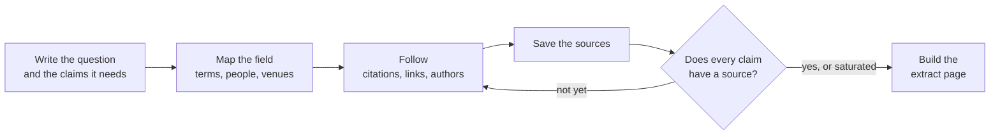

# imozuru

<picture>
  <source media="(prefers-color-scheme: dark)" srcset="assets/brand/logo/imozuru-lockup-light.svg">
  
</picture>

[日本語](README.md) | English

A Claude Code skill that digs into an unfamiliar field, starting from not even knowing its vocabulary and ending at the original sources.

Ask an AI to "look into" something and it usually searches, reads the top few hits, and hands back a summary.
imozuru makes the AI search the way research on human information seeking says people do: Bates's berrypicking, Ellis's model of information-seeking behaviour, and Kuhlthau's Information Search Process.
It first identifies the field's terms, its central people, and its venues, then follows citations, links, and authors like pulling sweet potatoes up by the vine, and saves the sources that matter to disk as they are.

The name comes from *imozuru-shiki* (芋づる式), the Japanese idiom for things coming up one after another, like potatoes on a single vine.

> **Language note**: The skill's instructions (`SKILL.md`), the messages from its scripts, and the labels on the extract page are in Japanese. Claude reads the instructions in any language, but this skill has only been tried with requests written in Japanese.

## What it does



- **Map the field**: run two searches that differ in approach (for example, one in English and one in Japanese), collect the terms, people, venues, and standard references, and write them to `map.md`
- **Follow the trail**: go backward through references, forward through citing works, follow authors, and read a venue end to end. The same moves work in fields with papers and in fields that live only in personal blogs and videos
- **Save the sources**: store PDFs, articles, and YouTube captions in `sources/`. 404 pages and login walls are caught by looking at the content
- **No summaries**: the agent does not summarise sources. For each claim it points to "which file, which lines", and the person reading the sources makes the judgement
- **Stop on evidence**: decide up front which claims are needed to answer the question, and stop when every one of them has a source, or when hardly any new sources turn up
- **Extract page**: build an HTML page that lists passages cut verbatim from the sources, claim by claim. A script checks that every extract appears word for word at the given lines; if any paraphrase slipped in, it stops instead of building the page
- **Watch**: pull new posts from the places the dig turned up (Qiita and Zenn tags, note, YouTube, blogs, arXiv) via RSS, and list each with the first line of its text

## Install

Install with the [skills](https://github.com/vercel-labs/skills) CLI.

```sh
npx skills add MaryCache/imozuru
```

To install by hand, copy `skills/imozuru/` to `~/.claude/skills/imozuru/`.

## Requirements

The scripts run on the Python 3.10+ standard library alone. They use the following commands when available.

| Command | Used for | When missing |
|---|---|---|
| `pdftotext` (poppler or Xpdf) | Turning PDFs into text | The PDF text cannot be read and the fetch reports `FAIL` |
| `pdftoppm` (poppler or Xpdf) and `tesseract` | OCR for old PDFs with no text layer | That PDF reports `FAIL` |
| `yt-dlp` | Downloading YouTube captions | Videos report `FAIL` |
| [ax](https://github.com/yusukebe/ax) | Turning HTML into Markdown | Falls back to the standard library (ax keeps headings and tables better) |

`chain.py`, which follows citations, uses the [OpenAlex](https://openalex.org/) API. No API key is needed.

## Usage

Ask Claude Code something like this.

```
芋づる式に調べて: 歌ってみたの MIX で、上手い人がどういう順番で処理しているか
(Dig into this: in vocal-cover mixing, in what order do skilled mixers apply their processing?)
```

```
Gaussian Splatting ってよく聞くけど全然わからない。論文とか解説の流れを掘ってほしい
(I keep hearing about Gaussian Splatting but have no idea what it is. Dig through the papers and explainers.)
```

```
/imozuru watch react
```

Results go to `~/research/<topic>/`.

```
map.md         question, needed claims, terms, people, venues, source table, next leads
log.md         per round: what was searched, what turned up, decisions and why
sources/       saved sources
extracts.json  extracts
report.html    extract page
```

A sample extract page is in `examples/demo/`. To try just the script, this builds `report.html`.

```sh
python3 skills/imozuru/scripts/report.py examples/demo
```

## Design

### No summaries

Summarising in detail during the confused early stage of a search invites premature closure (Kuhlthau 1991).
The agent only saves sources and points at locations; the person reading them makes the judgement.

### Stop on evidence

Decide 3 to 6 claims needed to answer the question, and stop once every one has a location in a source (HALT; Roh & Han 2026).
Claims are easy to make too lenient, so at least one must carry a condition from the request's own wording, and more than half must be impossible to answer without reading a source.

The other stopping point is saturation.
Run two searches that differ in approach (for example, English and Japanese), and stop when 70% or more of the sources they list are already on the map.
This borrows the idea of estimating a total from the overlap between two independent searches (Kastner 2007).
The 70% is a working threshold set while trying the skill out; its grounding is still weak.

### Don't commit to one direction too early

When several directions are still possible, AI search tends to pick one, and later searches reinforce that path until it fails (Zhou et al. 2026, HypoSearch).
When in doubt, run two searcher agents on different hypotheses in parallel and compare when they come back.

### Fields without papers: follow personal writing

In fields with few papers, such as painting techniques or audio mixing, the know-how lives in personal blogs and videos.
The skill follows links inside articles and "I based this on so-and-so's post" the same way it follows a paper's references.
Each saved source gets a type label, and which to trust is left to the reader.

- [Paper] peer-reviewed or conference papers, arXiv preprints
- [First-hand] a record by the person who did it (the process of trying, making, or measuring it themselves)
- [Observation] notes on someone else's work or methods
- [Roundup] articles that collect or restate others' findings
- [Official] documents from the maker of the tool or product

### Extracts are checked by machine

Dozens of saved sources go unread.
The step in between is extracting, one of Ellis's behaviours.
`report.py` checks that each extract appears verbatim at the given lines of its source, and if even one word was paraphrased, it stops without building the page.

## Where the rules come from

`skills/imozuru/references/theory.md` lists which paper, and which part of it, each rule in the skill comes from (in Japanese).

## Cautions

- The searcher subagents search the web, so the content of your question leaves your machine as search terms. Don't use the skill for research involving confidential or personal data
- The skill does not use ways around paywalls. Sources it cannot reach are reported as "not reached"
- Saved sources are copies for reading locally. Don't redistribute them

## License

MIT
