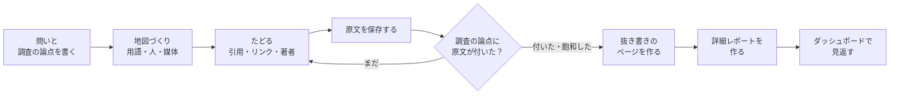

# imozuru

<picture>
  <source media="(prefers-color-scheme: dark)" srcset="assets/brand/logo/imozuru-lockup-light.svg">
  
</picture>

日本語 | [English](README.en.md)

imozuruは知らない分野を原文にたどりつくまで芋づる式に掘るClaude Codeのスキルです。
Batesのberrypicking、Ellisの探索行動のモデル、Kuhlthauの探索過程の研究など、図書館情報学の情報探索の研究から考え方を応用しています。

AIの判断能力は、形式知・ノウハウを収集することで強化されます。
原文に書かれた形式知・ノウハウを集めて、AIの判断の材料にすることが、imozuruの元からの役割です。

2.0のメジャーアップデートでは、人間が読むことに重点を置いて強化しました。
調べた分野を読み手の水準に合わせて解説する詳細レポートと、すべての調査を1枚で見返せるダッシュボードを追加しています。
版ごとの変更は [CHANGELOG.md](CHANGELOG.md) に記載しています。

## 既存のAI調査手法との差別化点

スキルなしで「調べて」と頼むと、LLMは検索上位の数件を読んで要約を返しがちです。
要約はすぐに読めますが、判断に必要な細部が抜け落ちやすくなります。
分野の用語を知らないうちは検索語も選べないため、検索は最初に思いついた言葉の範囲にとどまってしまいます。

imozuruはまず『分野の用語・中心にいる人・知見が集まる媒体』を押さえ、そこから引用やリンク、著者をたどって原文を集めます。
集めた原文は要約せずに保存し、答えに必要な論点ごとに「どのファイルの何行目か」を示すところまでにとどめます。
AIは集めた原文を材料に判断し、ユーザーは示された場所の原文を読んで、その判断の根拠を確認できます。

## スキルのフロー



Claudeはまず、問いと、答えるために必要な論点を3〜6個書き出します。
次に、探し方を変えた2本の検索役（Webを検索するサブエージェント）で用語、人、媒体を集め、地図（`map.md`）にまとめます。
その後、原文が見つかるまで参考文献や被引用、著者をたどっていきます。
論文のない分野では、記事の中のリンクや「〇〇さんの記事を参考にした」という記述をたどります。

見つけた原文は `sources/` に保存し、404やログインを求めるページは中身を見て除きます。
すべての論点に原文が付くか、新しい資料が出てこなくなったら探すのをやめます。
最後に、原文から切り出した文を論点ごとに並べたページ（抜き書きのページ）と、その分野の解説（詳細レポート）を作ります。

見張りのモード（`/imozuru watch <話題>`）は、ここまでの調査の流れとは別に動きます。
掘って見つけた媒体（QiitaやZennのタグ、note、YouTube、ブログ、arXiv）の新着をRSSで集めて並べます。

## 入れ方

### Claude Code のプラグイン

このリポジトリをマーケットプレイスとして追加し、プラグインとして入れます。

```text
/plugin marketplace add MaryCache/imozuru
/plugin install imozuru@imozuru
```

プラグインには版の番号を付けていないので、main にコミットが入るたびに新しい版として扱われます。
自動で最新にしたいときは、`/plugin` のマーケットプレイスの画面で imozuru の自動更新を入れてください。
手で更新するときは `claude plugin marketplace update imozuru` を実行します。

### skills のCLI

[skills](https://github.com/vercel-labs/skills) のCLIでも入れられます。

```sh
npx skills add MaryCache/imozuru
```

手動の場合は、`skills/imozuru/` を `~/.claude/skills/imozuru/` にコピーしてください。

## 必要なもの

スクリプトはPython 3.10以上の標準ライブラリだけで動き、次のコマンドは入っていれば使います。

| コマンド | 使う場面 | 入っていない場合 |
|---|---|---|
| `pdftotext`（popplerかXpdf） | PDFから本文を取り出す | PDFの本文が取れず `FAIL` になる |
| `pdftoppm`（popplerかXpdf）と `tesseract` | 文字の層がない古いPDFをOCRにかける | そのPDFは `FAIL` になる |
| `tesseract` の言語データ `jpn` と `jpn_vert` | 日本語のスキャンPDFを、横書きも縦書きも読む（入っていれば自動で使う。環境変数 `IMOZURU_OCR_LANG` で `jpn+eng` のように指定もできる） | 英語だけで読む。日本語のPDFは読み取りの確信度が低いので `FAIL` になる |
| `yt-dlp` | YouTubeの字幕を取得する | 動画は `FAIL` になる |
| [ax](https://github.com/yusukebe/ax) | HTMLをmarkdownにする | 標準ライブラリで文字だけを取り出す（見出しや表の形はaxのほうがよく残る） |

引用をたどる `chain.py` は [OpenAlex](https://openalex.org/) のAPIを使いますが、APIキーは必要ありません。

## 使い方

Claude Codeで、次のように頼みます。

```
芋づる式に調べて: 歌ってみたのMIXで、上手い人がどういう順番で処理しているか
```

```
Gaussian Splattingってよく聞くけど全然わからない。論文とか解説の流れを掘ってほしい
```

```
/imozuru watch react
```

結果は `~/research/<話題>/` に、次の形で保存されます。

```
map.md         問い・題・調査の論点・用語・人・媒体・原文の表・次の手がかり
log.md         周ごとに、何を探して何が出たか・判断とその理由
sources/       保存した原文
extracts.json  抜き書き
report.html    抜き書きのページ
queries.jsonl  検索語ごとのヒットの全件
fetch-log.jsonl 取得の記録（URL と OK/FAIL）
digest.json    詳細レポートの解説
digest.html    詳細レポート（Lv1〜Lv3 の解説と、検索の全記録）
```

## 人間が読む・見返す

集めた原文は、人間が読んで判断できる形で見せます。

### 抜き書きのページ

原文から切り出した文を、調査の論点ごとに並べたページです。
見本は `examples/demo/` にあり、次のコマンドでスクリプトだけを試せます。

```sh
python3 skills/imozuru/scripts/report.py examples/demo
```

切り出した文を機械で照合する理由は、下の「抜き書きを機械で照合する理由」に書いています。

### 詳細レポート

調べた分野を、前提知識の違う読み手ごとに3編で解説するページです。
解説の1文ごとに原文の引用が根拠として付き、何を探して何が出たかの全記録も一緒に載ります。

調べ終えたあとにClaudeが解説を書き、`digest.py` が引用を原文と照合してからページにします。
解説と記録の2層に分けた理由は下の「詳細レポートの2層」に書いています。

### 調査記録のダッシュボード


2.0で追加したページです。
調査の置き場（既定 `~/research`）にあるすべての調査を、トピックごとに1枚のページへまとめます。
トピックは1つの問いを調べたひとまとまりで、`~/research` の中のフォルダ1つに当たります。

```sh
python3 skills/imozuru/scripts/dashboard.py ~/research
```

`~/research/index.html` ができます。

ホームには、調べるのをやめた理由（終了理由）・原文の取得元・引用やリンクをたどった回数（周回数）の集計が並びます。
左のサイドバーからトピックを選ぶと、調査の論点・周回数・原文・文書をまとめたトピック詳細が開き、詳細レポートや抜き書きもその中で読めます。
サイドバーの検索は題名・疑問・用語・人物・媒体を対象にし、ひらがなやローマ字でも一致します。
画面の使い方は右上の「?」から開くヘルプにまとめています。

### スマホで見る

ダッシュボードを配信すると、スマホのブラウザからも閲覧できます。

```sh
IMOZURU_SERVE_TOKEN=<合言葉> python3 skills/imozuru/scripts/dashboard.py ~/research --serve 8765
tailscale serve --bg 8765
```

配信はPCの中（127.0.0.1）だけで待ち受け、合言葉の付いたURLでしか開けません。
スマホからはTailscaleで自分の機器にだけ中継して、`https://<PCの名前>.<tailnet>.ts.net/?k=<合言葉>` を開きます。
`<tailnet>` は、Tailscaleの管理画面に出るネットワークの名前です。

合言葉は環境変数 `IMOZURU_SERVE_TOKEN` で固定できます（16文字以上）。
固定しないと起動のたびに変わり、ホーム画面に追加したアイコンから開けなくなります。

## 設計の考え方

### 要約しない理由

Kuhlthau（1991）は、調べ始めの混乱した段階で詳しくまとめると、早すぎる閉じ（premature closure）を招き、探索の過程が妨げられると述べています。
そのためimozuruは、調べている間は原文の場所を示すところまでにとどめています。
解説を書くのは、止める判定が出たあとの詳細レポートだけです。

### 止めどきの決め方

止める条件は2つです。
1つ目は、すべての論点に原文の場所が付くことで、証拠がそろったかで止めどきを決めるRohとHan（2026）のHALTにならいました。
論点が原文を読まずに答えられる形ばかりにならないよう、少なくとも1つは依頼の言葉の条件をそのまま含め、半分以上は原文を読まないと答えられない形にしています。

2つ目は飽和で、2本の検索役が挙げた資料の7割以上がすでに地図にあれば止めます。
独立した2回の探索の重なりから全体の数を見積もる考え方（Kastner 2007）を借りたもので、7割は試行で決めた仮の目安です。

### 方向を1つに決めない理由

Zhouら（2026）のHypoSearchによると、AIの検索は方向がいくつもありうる段階で1つを選び、後の検索も同じ方向へ重ねて失敗しがちです。
そこで迷ったときは、別の仮説を持たせた検索役を2本並べ、結果を比べてから進みます。

### 論文のない分野の扱い

塗り方やMIXのように論文がほとんどない分野では、知見の多くが個人のブログや動画にあります。
imozuruはそうした記事も論文と同じようにたどるので、保存した原文には次の印を付け、どれを信じるかはユーザーに任せています。

- 〔論文〕査読や学会を通ったもの、arXivのプレプリント
- 〔本人〕やった本人の記録（自分で試した、作った、測った過程が書いてあるもの）
- 〔観察〕他人の作品ややり方を見て、特徴を書き出したもの
- 〔まとめ〕他人の知見を集めたり言い換えたりした記事
- 〔公式〕道具や製品を作った側の文書

### 抜き書きを機械で照合する理由

原文を何十本も保存しただけでは、どこから読めばよいか分かりません。
そこでEllisのモデルにある抜き書き（extracting）にならい、論点ごとに原文の該当部分を切り出したページを作ります。
Claudeが切り出すときに言い換えが紛れ込まないよう、`report.py` は、切り出した文が原文の指定の行にそのまま在るかを照合し、1語でも違えばページを作りません。

### 詳細レポートの2層

詳細レポートは2.0で追加した文書です。
抜き書きだけでは、その分野を知らない人には言葉の意味も読む順も分かりません。
そこで止めたあとに、解説と記録の2層からなる詳細レポートを作ります。
解説は読み手の水準で3編に分けます。

- Lv1：前提知識の無い人向けに、何が起きているかを書きます。
- Lv2：近い分野を知っている人向けに、仕組みを書きます。
- Lv3：その分野の専門の人向けに、通説の修正や未決着の点を書きます。

どの編も1文ごとに原文からの引用を根拠として付けます。
`digest.py` は抜き書きと同じ方法で引用を照合し、根拠の無い文が1つでもあればページを作りません。
記録は検索語ごとのヒットの全件と取得の結果から機械で組むので、空振りの検索語も含めて、何を探して何が出たかがそのまま見えます。

## 決まりの出典

スキルの各決まりがどの論文のどこから来ているかは、`skills/imozuru/references/theory.md` にまとめています。

## 注意点

- 検索役はWebを検索するため、問いの内容が検索語として外部に送られます。機密情報や個人データが関わる調べものには使わないでください。
- 有料の論文を回避して入手する手段は使わず、取得できなかったものは「届かなかった」と報告します。
- 保存した原文は手元で読むための写しなので、再配布しないでください。
- 原文を取るスクリプトは、http(s) 以外のURLと、手元や内側の宛先（127.0.0.1、192.168.x.xなど）には取りに行きません。検索結果に細工したURLを置かれて、手元で動いているサービスの中身を読まれないようにするためです。VPNやプロキシの道具によっては、外のサイトの名前まで内側の宛先に引けることがあり、そのときは何も取れなくなります。その場合だけ、環境変数 `IMOZURU_ALLOW_PRIVATE=1` を設定すると、この宛先の検査を外せます。

## ライセンス

MIT
