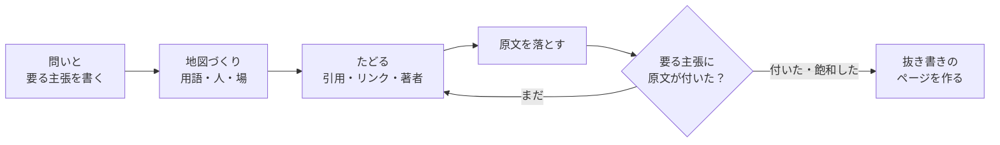

# imozuru

<picture>
  <source media="(prefers-color-scheme: dark)" srcset="assets/brand/logo/imozuru-lockup-light.svg">
  
</picture>

日本語 | [English](README.en.md)

知らない分野を、言葉を知らないところから原文にたどりつくまで掘る Claude Code のスキル。

「調べて」とだけ頼むと、AI はたいてい検索して上から数件を読み、要約を返す。
imozuru は、人の情報探索の研究（Bates の berrypicking、Ellis の探索行動のモデル、Kuhlthau の探索過程）が示した探し方を AI にやらせる。
界隈の用語・中心の人・場を先に特定し、引用・リンク・著者を芋づる式にたどって、当たりの原文をそのまま手元に落とす。

## 何をするか



- **地図を作る**: 違う探し方の2本（英語と日本語など）で、用語・人・場・定番の資料を集めて `map.md` に書く
- **たどる**: 参考文献を後ろへ、被引用を前へ、著者で追う、場を通しで見る。論文の分野でも、個人のブログや動画しかない分野でも同じ動きでたどる
- **原文を落とす**: PDF・記事・YouTube の字幕を `sources/` に保存する。404 やログインの壁は中身を見て弾く
- **要約しない**: 原文を要約せず、主張ごとに「どのファイルの何行目か」を指す。判断するのは原文を読む人
- **証拠で止める**: 最初に「答えるのに要る主張」を決め、その全部に原文が付くか、新しい資料がほとんど出なくなったら止める
- **抜き書きのページ**: 原文からそのまま切り出した文を主張ごとに並べた HTML を作る。抜き書きが原文の指定の行にそのまま在るかを機械で照合し、言い換えが混ざっていたら作らずに止まる
- **見張る**: 掘って見つけた場所（Qiita・Zenn のタグ、note、YouTube、ブログ、arXiv）の新着を RSS で引き、原文の冒頭1行つきで並べる

## 入れ方

[skills](https://github.com/vercel-labs/skills) の CLI で入れる。

```sh
npx skills add MaryCache/imozuru
```

手で入れるなら、`skills/imozuru/` を `~/.claude/skills/imozuru/` に写す。

## 要るもの

スクリプトは Python 3.10 以上の標準ライブラリだけで動く。次のコマンドは、あれば使う。

| コマンド | 使うところ | 無いとき |
|---|---|---|
| `pdftotext`（poppler か Xpdf） | PDF を文字にする | PDF の本文が取れず `FAIL` になる |
| `pdftoppm`（poppler か Xpdf）と `tesseract` | 文字の層が無い古い PDF の OCR | その PDF は `FAIL` になる |
| `yt-dlp` | YouTube の字幕を落とす | 動画は `FAIL` になる |
| [ax](https://github.com/yusukebe/ax) | HTML を markdown にする | 標準ライブラリで文字にする（見出しや表の形は ax のほうが残る） |

引用をたどる `chain.py` は [OpenAlex](https://openalex.org/) の API を使う。API キーは要らない。

## 使い方

Claude Code で、こう頼む。

```
芋づる式に調べて: 歌ってみたの MIX で、上手い人がどういう順番で処理しているか
```

```
Gaussian Splatting ってよく聞くけど全然わからない。論文とか解説の流れを掘ってほしい
```

```
/imozuru watch react
```

結果は `~/research/<話題>/` に置かれる。

```
map.md         問い・要る主張・用語・人・場・原文の表・次の手がかり
log.md         周ごとに、何を探して何が出たか・判断とその理由
sources/       落とした原文
extracts.json  抜き書き
report.html    抜き書きのページ
```

抜き書きのページの見本は `examples/demo/` にある。スクリプトだけ試すなら、次で `report.html` ができる。

```sh
python3 skills/imozuru/scripts/report.py examples/demo
```

## 設計の考え方

### 要約しない

調べ始めの混乱した段階で詳しくまとめると、早すぎる閉じ（premature closure）を招く（Kuhlthau 1991）。
エージェントは原文を落として場所を指すだけにし、判断は原文を読む人がする。

### 止めどきを証拠で決める

最初に「答えるのに要る主張」を3〜6個決め、その全部に原文の場所が付いたら止める（HALT・Roh & Han 2026）。
主張は甘く作れてしまうので、少なくとも1つは依頼の言葉の条件をそのまま入れ、半分以上は原文を読まないと答えられない形にする。

もう一つの止めどきは飽和。
違う探し方の2本（英語と日本語など）を並べ、挙がった資料の7割以上がすでに地図にあれば止める。
独立した2回の探索の重なりから全体の数を見積もる考え方（Kastner 2007）を借りた。
7割は試しながら決めた目安で、根拠はまだ弱い。

### 方向を決め打ちしない

AI の検索は、方向がいくつもありうる段階で1つを選び、その後の検索が同じ道を強めて失敗する（Zhou ら 2026 HypoSearch）。
迷ったら別の仮説で検索役を2本並べ、戻ってから比べる。

### 論文の無い分野は個人の発信をたどる

塗り方や MIX のように論文がほとんど無い分野の知恵は、個人のブログや動画にある。
論文の参考文献をたどるのと同じ動きで、記事の中のリンクや「〇〇さんの記事を参考に」をたどる。
落とした原文には種類の印を付け、どれを信じるかは読む人に任せる。

- 〔論文〕査読や会議を通ったもの、arXiv のプレプリント
- 〔本人〕やった本人の記録（自分で試した・作った・測った過程が書いてある）
- 〔観察〕他人の作品ややり方を見て、特徴を書き出したもの
- 〔まとめ〕他人の知見を集めた・言い換えた記事
- 〔公式〕道具や製品を作った側の文書

### 抜き書きを機械で照合する

原文を何十本も落としただけでは読まれない。
間を取るのが Ellis の動きの一つである抜き書き（extracting）。
`report.py` は抜き書きの文が原文の指定の行にそのまま在るかを照合し、1語でも言い換えが混ざっていればページを作らずに止まる。

## 決まりの出典

スキルの各決まりがどの論文のどこから来たかは `skills/imozuru/references/theory.md` に並べた。

## 気をつけること

- 検索役のサブエージェントは Web を検索するので、問いの中身が検索語として外に出る。機密や個人データが絡む調べものには使わない
- 有料の論文を回避する手段は使わない。取れないものは「届かなかった」と報告する
- 落とした原文は手元で読むための写し。再配布しない

## ライセンス

MIT
