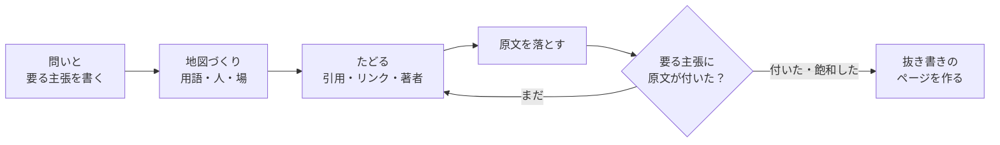

# imozuru

<picture>
  <source media="(prefers-color-scheme: dark)" srcset="assets/brand/logo/imozuru-lockup-light.svg">
  
</picture>

日本語 | [English](README.en.md)

imozuruは、知らない分野を、原文にたどりつくまで芋づる式に掘るClaude Codeのスキルです。
Batesのberrypicking、Ellisの探索行動のモデル、Kuhlthauの探索過程の研究など、図書館情報学の情報探索の研究から、考え方を応用しています。

## ふつうに頼んだときとの違い

スキルなしで「調べて」と頼むと、LLMは検索上位の数件を読んで要約を返します。
要約はすぐに読めますが、判断に必要な細部が落ちやすい欠点を抱えています。
分野の用語を知らないうちは検索語も選べないため、最初に思いついた言葉の範囲から先へ進めません。

imozuruはまず分野の用語、中心にいる人、知見が集まる場を押さえ、そこから引用やリンク、著者をたどって原文を集めます。
集めた原文は要約せずに保存し、答えに必要な主張ごとに「どのファイルの何行目か」を示すに留まります。
原文を読んで判断するのは、ユーザー自身です。

## 動き方



Claudeはまず、問いと、答えるために必要な主張を3〜6個書き出します。
次に、探し方を変えた2本の検索役（Webを検索するサブエージェント）で用語、人、場を集め、地図（`map.md`）にまとめます。
その後、原文が見つかるまで参考文献や被引用、著者をたどっていきます。
論文のない分野では、記事の中のリンクや「〇〇さんの記事を参考にした」という記述をたどります。

見つけた原文は `sources/` に保存し、404やログインを求めるページは中身を見て除きます。
すべての主張に原文が付くか、新しい資料が出てこなくなったら探すのをやめます。
最後に、原文から切り出した文を主張ごとに並べたページ（抜き書きのページ）を作ります。

見張りのモードでは、掘って見つけた場（QiitaやZennのタグ、note、YouTube、ブログ、arXiv）の新着をRSSで集めて並べます。

## 入れ方

### Claude Code のプラグイン

このリポジトリをマーケットプレイスとして追加し、プラグインとして入れます。

```text
/plugin marketplace add MaryCache/imozuru
/plugin install imozuru@imozuru
```

プラグインには版の番号を付けていないので、main にコミットが入るたびに新しい版として扱われます。
自動で最新にしたいときは、`/plugin` のマーケットプレイスの画面で imozuru の自動更新を入れてください。
手で更新するときは `claude plugin marketplace update imozuru` を流します。

### skills のCLI

[skills](https://github.com/vercel-labs/skills) のCLIでも入れられます。

```sh
npx skills add MaryCache/imozuru
```

手動の場合は、`skills/imozuru/` を `~/.claude/skills/imozuru/` にコピーしてください。

## 必要なもの

スクリプトはPython 3.10以上の標準ライブラリだけで動き、次のコマンドは入っていれば使います。

| コマンド | 使う場面 | 入っていない場合 |
|---|---|---|
| `pdftotext`（popplerかXpdf） | PDFから本文を取り出す | PDFの本文が取れず `FAIL` になる |
| `pdftoppm`（popplerかXpdf）と `tesseract` | 文字の層がない古いPDFをOCRにかける | そのPDFは `FAIL` になる |
| `yt-dlp` | YouTubeの字幕を取得する | 動画は `FAIL` になる |
| [ax](https://github.com/yusukebe/ax) | HTMLをmarkdownにする | 標準ライブラリで文字だけを取り出す（見出しや表の形はaxのほうがよく残る） |

引用をたどる `chain.py` は [OpenAlex](https://openalex.org/) のAPIを使いますが、APIキーは必要ありません。

## 使い方

Claude Codeで、次のように頼みます。

```
芋づる式に調べて: 歌ってみたのMIXで、上手い人がどういう順番で処理しているか
```

```
Gaussian Splattingってよく聞くけど全然わからない。論文とか解説の流れを掘ってほしい
```

```
/imozuru watch react
```

結果は `~/research/<話題>/` に、次の形で保存されます。

```
map.md         問い・要る主張・用語・人・場・原文の表・次の手がかり
log.md         周ごとに、何を探して何が出たか・判断とその理由
sources/       落とした原文
extracts.json  抜き書き
report.html    抜き書きのページ
```

抜き書きのページの見本は `examples/demo/` にあり、次のコマンドでスクリプトだけを試せます。

```sh
python3 skills/imozuru/scripts/report.py examples/demo
```

## 設計の考え方

### 要約しない理由

Kuhlthau（1991）は、調べ始めの混乱した段階で詳しくまとめると、早すぎる閉じ（premature closure）を招き、探索の過程が妨げられると述べています。
そのためimozuruは、原文の場所を示すところまでにとどめています。

### 止めどきの決め方

止める条件は2つです。
1つ目は、すべての主張に原文の場所が付くことで、証拠がそろったかで止めどきを決めるRohとHan（2026）のHALTにならいました。
主張が甘くならないよう、少なくとも1つは依頼の言葉の条件をそのまま含め、半分以上は原文を読まないと答えられない形にしています。

2つ目は飽和で、2本の検索役が挙げた資料の7割以上がすでに地図にあれば止めます。
独立した2回の探索の重なりから全体の数を見積もる考え方（Kastner 2007）を借りたもので、7割は試しながら決めた仮の目安です。

### 方向を1つに決めない理由

Zhouら（2026）のHypoSearchによると、AIの検索は方向がいくつもありうる段階で1つを選び、後の検索でもその道を選び続けて失敗しがちです。
そこで迷ったときは、別の仮説を持たせた検索役を2本並べ、結果を比べてから進みます。

### 論文のない分野の扱い

塗り方やMIXのように論文がほとんどない分野では、知見の多くが個人のブログや動画にあります。
imozuruはそうした記事も論文と同じようにたどるので、保存した原文には次の印を付け、どれを信じるかはユーザーに任せています。

- 〔論文〕査読や学会を通ったもの、arXivのプレプリント
- 〔本人〕やった本人の記録（自分で試した、作った、測った過程が書いてあるもの）
- 〔観察〕他人の作品ややり方を見て、特徴を書き出したもの
- 〔まとめ〕他人の知見を集めたり言い換えたりした記事
- 〔公式〕道具や製品を作った側の文書

### 抜き書きを機械で照合する理由

原文を何十本も保存しただけでは、どこから読めばよいか分かりません。
そこでEllisのモデルにある抜き書き（extracting）にならい、主張ごとに原文の該当部分を切り出したページを作ります。
`report.py` は、切り出した文が原文の指定の行にそのまま在るかを照合し、1語でも違えばページを作りません。

## 決まりの出典

スキルの各決まりがどの論文のどこから来ているかは、`skills/imozuru/references/theory.md` にまとめています。

## 注意点

- 検索役はWebを検索するため、問いの内容が検索語として外部に送られます。機密情報や個人データが関わる調べものには使わないでください。
- 有料の論文を回避して入手する手段は使わず、取得できなかったものは「届かなかった」と報告します。
- 保存した原文は手元で読むための写しなので、再配布しないでください。
- 原文を取るスクリプトは、http(s) 以外のURLと、手元や内側の宛先（127.0.0.1、192.168.x.xなど）には取りに行きません。検索結果に細工したURLを置かれて、手元で動いているサービスの中身を読まれないようにするためです。VPNやプロキシの道具によっては、外のサイトの名前まで内側の宛先に引けることがあり、そのときは何も取れなくなります。その場合だけ、環境変数 `IMOZURU_ALLOW_PRIVATE=1` を設定すると、この宛先の検査を外せます。

## ライセンス

MIT
